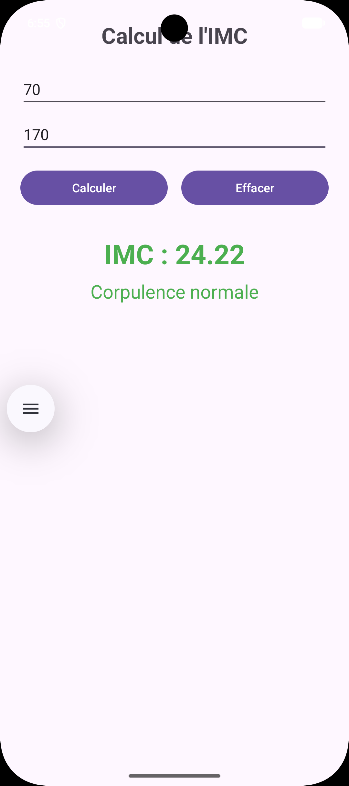
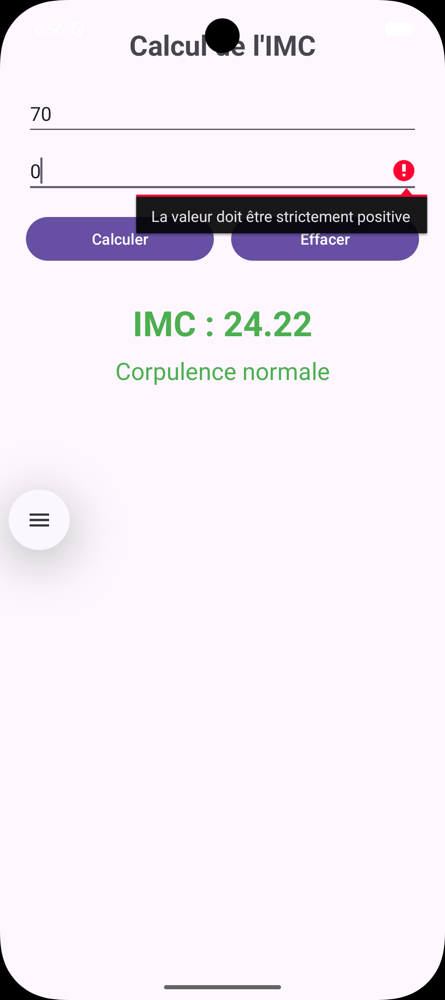

# CalculIMC

Application Android (Kotlin) qui calcule l'indice de masse corporelle (IMC) à partir du poids et de la taille saisis par l'utilisateur, puis affiche la valeur obtenue et une catégorie colorée.

TP Android Studio, Licence DSI, ISET.

## Fonctionnalités

- Saisie du poids (kg) et de la taille (m), avec clavier numérique décimal
- Calcul de l'IMC : `poids / (taille × taille)`, arrondi à deux décimales
- Affichage de la catégorie avec une couleur adaptée
- Contrôle des saisies : champ vide, valeur nulle ou négative, saisie incorrecte
- Bouton **Effacer** : vide les champs, supprime le résultat et replace le curseur dans le poids
- L'application ne se ferme pas en cas de saisie incorrecte

## Interprétation

| IMC | Catégorie | Couleur |
|---|---|---|
| < 18,5 | Insuffisance pondérale | Orange |
| 18,5 à < 25 | Corpulence normale | Vert |
| 25 à < 30 | Surpoids | Orange |
| 30 à < 35 | Obésité modérée | Rouge |
| 35 à < 40 | Obésité sévère | Rouge |
| ≥ 40 | Obésité morbide | Rouge foncé |

## Captures d'écran

| Calcul valide | Erreur de saisie |
|---|---|
|  |  |

## Fichiers principaux

- `app/src/main/res/layout/activity_main.xml` : interface
- `app/src/main/java/com/example/calculeimc/MainActivity.kt` : logique de l'application
- `app/src/main/res/values/strings.xml` : textes de l'application

## Lancer le projet

1. Cloner le dépôt puis l'ouvrir avec Android Studio.
2. Attendre la fin de la synchronisation Gradle.
3. Lancer l'application sur un émulateur ou un téléphone (API 24 minimum).
